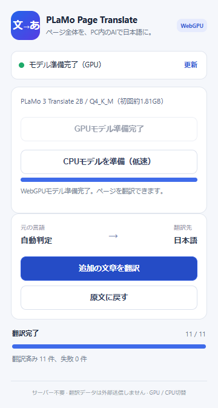

<div align="center">


# Page Translate

**ブラウザ内で動作するローカル翻訳拡張**

個人開発 · Chrome向け · WebGPU / CPU対応

[](https://github.com/Kaito-Rowing/PLaMo-Page-Translate/releases/latest)
[](https://github.com/Kaito-Rowing/PLaMo-Page-Translate/actions/workflows/test.yml)
[](#動作環境)
[](LICENSE)

[**ダウンロード**](https://github.com/Kaito-Rowing/PLaMo-Page-Translate/releases/latest) · [インストール](#インストール) · [使い方](#使い方) · [セキュリティ](#セキュリティとプライバシー) · [FAQ](#faq)

</div>

---

Page Translateは、**PLaMo 3 Translate 2Bをブラウザ内で動かす**Chrome拡張です。開いているページを日本語に翻訳し、ボタンひとつで原文に戻せます。翻訳用サーバーやAPIキーの準備は不要です。

## 特徴

- **ローカルで翻訳** — 本文を外部の翻訳APIへ送信せず、PC内のWebGPUで推論。CPUモードも選べます。
- **リンクや書式を保持** — リンク・強調・インラインコードを含む段落をまとめて翻訳します。
- **原文へワンクリックで復元** — 翻訳中の取り消しにも対応します。
- **追加コンテンツにも対応** — ページに後から追加された文章を検出し、表示領域から優先して処理します。
- **モデルを保存して再利用** — 初回取得後は、保存済みモデルでオフラインでも推論できます。

<p align="center">
  <picture>
    <source media="(prefers-color-scheme: dark)" srcset="docs/images/popup-dark.png">
    
  </picture>
  <br>
  <sub>翻訳完了時のポップアップ</sub>
</p>

## セキュリティとプライバシー

**翻訳本文を外部の翻訳APIへ送信しない設計**です。ページへのアクセスや訳文の反映、拡張の更新にも、次の対策を実装しています。

| 対策 | 実装 |
| --- | --- |
| **PC内で翻訳** | 原文と文脈はChrome内のモデルで処理します。翻訳用サーバーへの送信やAPIキーは不要です。 |
| **操作したタブにアクセス** | ページへのスクリプト挿入には `activeTab` と `scripting` を使用。全サイトへの常時アクセスを要求せず、ユーザーが拡張を開いたタブで動作します。 |
| **モデルの出力をコードとして実行しない** | 訳文はテキストとして反映。書式マーカーを検証し、元のDOM要素を使ってリンクや強調を復元します。 |
| **推論用コードを同梱** | JavaScript・Worker・WASMは拡張に同梱し、CSPでスクリプトの読み込み先を拡張内に限定しています。 |
| **更新ファイルを照合** | 更新ツールはZIPを公開SHA-256と照合し、必要なファイルと展開先を検証してから配置します。 |

モデルの取得・キャッシュ確認時にはHugging Faceへ、拡張の更新時にはGitHubへ通信します。翻訳の高速化のため、**原文・文脈・訳文は端末内にキャッシュ**されます。

権限、通信先、保存内容、更新検証の範囲は[セキュリティ・データの取り扱い](docs/security.md)に記載しています。[実装](extension/)も公開しています。

## インストール

Windowsでは同梱の更新ツールで配置できます。**管理者権限・Node.js・Python・CUDAの個別セットアップは不要**です。

1. [Releases](https://github.com/Kaito-Rowing/PLaMo-Page-Translate/releases/latest)から **`plamo-page-translate-webgpu.zip`** をダウンロードして解凍します。
2. **`Update-PLaMo.cmd`** を実行します。最新版を取得・検証し、固定フォルダーへ配置します。
3. Chromeで **`chrome://extensions/`** を開き、デベロッパーモードをONにします。**「パッケージ化されていない拡張機能を読み込む」**から、次のフォルダーを選択します。

```text
%LOCALAPPDATA%\PLaMoPageTranslate\extension
```

> GitHubの「Code → Download ZIP」はソースコードです。インストールには **ReleasesのZIP** を使ってください。

## 使い方

1. 翻訳したいWebページで、拡張のアイコンをクリックします。
2. **「GPUモデルを準備」**を押し、準備完了を待ちます。初回のみ約**1.81GB**のモデルを取得します。
3. **「ページ全体を翻訳」**を押します。元に戻すときは**「原文に戻す」**を押します。

GPUを利用できない場合は **「モデル設定」**を開き、**「CPUモデルを準備」**を選んでください（GPUより低速です）。ブラウザを再起動した後はモデルの準備が必要ですが、取得済みのモデルを再利用します。

## 動作環境

| 項目 | 条件 |
| --- | --- |
| ブラウザ | Chrome 137以降（最新版推奨） |
| Windows向け更新ツール | Windows PowerShell 5.1以降 |
| GPUモード | WebGPUとハードウェアアクセラレーションが有効な環境 |
| ストレージ | モデル保存用に約2GB以上の空き容量 |
| メモリ | モデル推論用の追加RAM／VRAMが必要 |

Windows / RTX 4070 12GBで実機検証しています。ソースからのビルドは他のOSでも可能ですが、同梱の更新ツールはWindows用です。

## 更新

次のファイルを実行して最新版を取得します。

```text
%LOCALAPPDATA%\PLaMoPageTranslate\Update-PLaMo.cmd
```

完了後、`chrome://extensions/` で拡張を **再読み込み**し、翻訳対象のWebページも再読み込みしてください。更新先は常に同じフォルダーで、前の拡張ファイルは `backups/` に保存します。

**Chromeの再読み込みボタンだけでは、最新版のダウンロードは行われません。**

## FAQ

<details>
<summary><strong>翻訳する文章は外部に送信されますか？</strong></summary>

本文は外部の翻訳APIへ送信しません。モデルはブラウザ内で動作します。原文・文脈・訳文のローカルキャッシュと、モデル取得・更新時の通信については[データの取り扱い](docs/security.md)を参照してください。

</details>

<details>
<summary><strong>どんなページでも翻訳できますか？</strong></summary>

通常のHTTP/HTTPSページが対象です。Chrome内部ページ、Chromeウェブストア、PDF、iframe、Shadow DOM内の文章には対応していません。

コードブロック、入力済みの値、編集中の文章、非表示要素、翻訳禁止要素は変更しません。1回の翻訳は最大1200件です。複雑な構造や書式込み1200文字を超える段落は、テキスト単位で処理します。

</details>

<details>
<summary><strong>専門用語や文章の訳が不自然になることはありますか？</strong></summary>

あります。段落の文脈やリンクを保って翻訳しますが、専門用語・多義語の誤訳や不自然な表現は残り得ます。詳しくは[段落翻訳の検証記録](docs/paragraph-translation.md)を参照してください。

</details>

<details>
<summary><strong>GPUが使えない・モデルの準備に失敗するときは？</strong></summary>

Chromeのバージョンとハードウェアアクセラレーションを確認してください。GPUを利用できない環境ではCPUモードを使えます。

準備や翻訳に失敗した場合は、拡張と対象ページを再読み込みし、モデルを再準備してください。ページの再読み込みや移動で、そのページの復元情報は消えます。

</details>

<details>
<summary><strong>旧版から移行するとき、モデルは再取得されますか？</strong></summary>

同じ登録先で更新する場合は、保存済みのモデルを再利用します。登録フォルダーを変更すると拡張IDが変わり、モデルの再取得が必要になる場合があります。新しい登録へ切り替える際は、旧版を無効にしてください。

更新に失敗した場合は、[リリースZIP](https://github.com/Kaito-Rowing/PLaMo-Page-Translate/releases/latest)を再取得してください。以前の登録先も同期する設定を使っている場合、そのフォルダーも保持してください。

</details>

## 開発

Node.js 22を推奨します。

```sh
npm ci
npm run build
```

生成された `dist/` をChromeへ読み込みます。テスト、実モデルでの検証、Windows向け更新ツール、リリースの手順は[開発ガイド](docs/development.md)を参照してください。

不具合の報告や改善の提案は[Issues](https://github.com/Kaito-Rowing/PLaMo-Page-Translate/issues)へ。Chromeのバージョン、GPU、エラーメッセージ、再現手順があると調査しやすくなります。

## ライセンス・謝辞

拡張本体は[MIT License](LICENSE)です。以下のプロジェクトを利用しています。

- [PLaMo 3 Translate 2B](https://huggingface.co/pfnet/plamo-3-translate-2b-GGUF) — Preferred Networksの翻訳モデル
- [wllama](https://github.com/ngxson/wllama) — ブラウザ向けのllama.cppバインディング
- [llama.cpp](https://github.com/ggml-org/llama.cpp) — モデル推論ランタイム

モデルの重みは同梱・再配布していません。モデルの利用には[公式モデルカード](https://huggingface.co/pfnet/plamo-3-translate-2b-GGUF)に記載された条件が適用されます。依存ライブラリのライセンスは配布物にも同梱しています。

---

[Releases](https://github.com/Kaito-Rowing/PLaMo-Page-Translate/releases) · [変更履歴](CHANGELOG.md) · [開発ガイド](docs/development.md) · [Issues](https://github.com/Kaito-Rowing/PLaMo-Page-Translate/issues)
